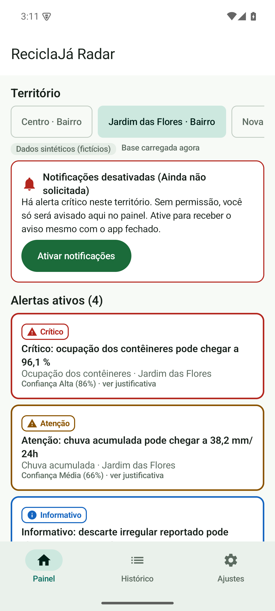
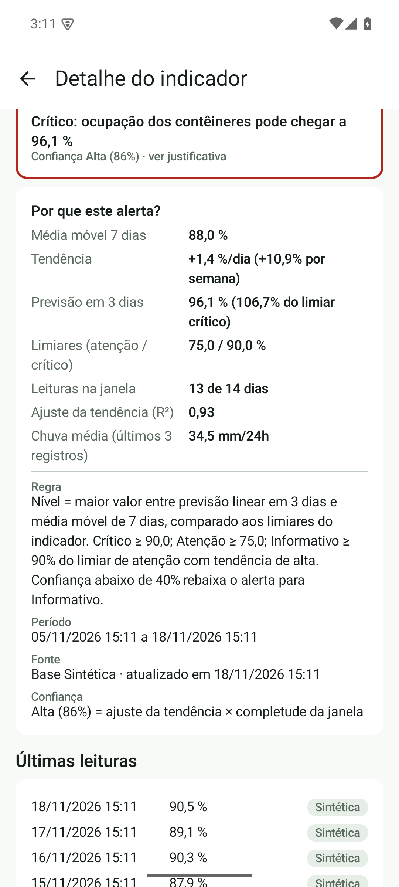
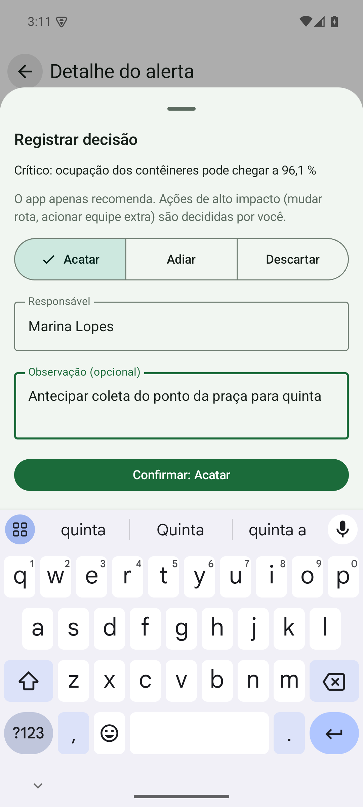
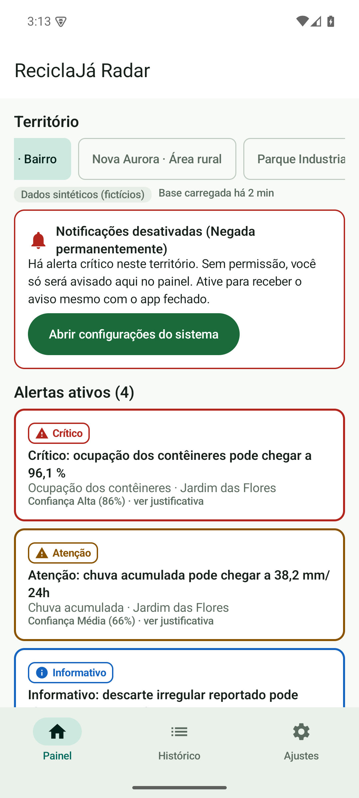

# ReciclaJá Radar

**Territory Intelligence Dashboard: GS2026.2 · Cross-Platform Application Development · CitizenTech**

[](https://github.com/gustavopmaia/gs2026-2-reciclaja-radar/actions/workflows/android.yml)

App Android (Kotlin + Jetpack Compose) que antecipa em até **3 dias** o transbordo de contêineres em pontos críticos de coleta, por bairro ou área rural. Cada alerta vem com **justificativa, confiança e fonte**. O app só recomenda: quem decide é o gestor, e a decisão (**acatar, adiar ou descartar**) fica registrada.

| Integrante | RM |
|---|---|
| Gabriel Fidalgo | RM563213 |
| Gustavo Maia | RM562240 |
| Gustavo Rossi | RM566075 |

Turma **2CCPY** · Grupo **ReciclaJá**

| Painel | Alerta e justificativa | Decisão humana | Permissão negada (plano B) |
|---|---|---|---|
|  |  |  |  |

## Entregáveis

| Item | Onde |
|---|---|
| Documento completo (PDF) | [`docs/GS2026.2_ReciclaJa_Radar.pdf`](docs/GS2026.2_ReciclaJa_Radar.pdf) ([versão Markdown](docs/GS2026.2_ReciclaJa_Radar.md)) |
| APK instalável | [`entregas/ReciclaJaRadar-1.0.0-release.apk`](entregas/) (minSdk 26 · targetSdk 36). Também sai como artefato de cada execução do CI |
| Vídeo (≤ 3 min) | ver `docs/VIDEO_URL.txt` |
| Evidências de qualidade | [`docs/evidencias/`](docs/evidencias) |
| Diagramas | [`docs/diagramas/`](docs/diagramas) (contexto, camadas, sequência do cenário crítico) |
| Dados sintéticos | [`tools/gerar_dados_sinteticos.py`](tools/gerar_dados_sinteticos.py) → [`app/src/main/assets/seed.json`](app/src/main/assets/seed.json) (CC0, fictícios) |

## Como rodar

Pré-requisitos: JDK 17 ou superior (o JBR do Android Studio serve) e Android SDK 36.

```bash
./gradlew testDebugUnitTest      # 15 testes do domínio (JVM, sem emulador)
./gradlew assembleRelease        # APK com R8 em app/build/outputs/apk/release/
adb install app/build/outputs/apk/release/app-release.apk
```

Ou abra a pasta no Android Studio e rode a configuração `app`. O app funciona **100% offline** (não declara a permissão INTERNET). Na primeira abertura, a base sintética é carregada no Room.

Roteiro rápido de teste:
1. Escolha **Jardim das Flores**: alerta **Crítico** de ocupação. Toque nele e leia a justificativa.
2. **Registrar decisão** → Acatar → responsável → confirmar. Veja na aba **Histórico**.
3. **Sítio Boa Vista** (dados desatualizados), **Parque Industrial** (insuficientes) e **Nova Aurora** (sem dados): o app avisa e não emite alerta.
4. **Ativar notificações** → negar duas vezes → o botão vira "Abrir configurações do sistema". O alerta segue visível no painel (plano B).

## Arquitetura

Camadas (blueprint da disciplina) + MVVM com fluxo unidirecional:

```
ui/ (Compose: telas, componentes, tema)
  └─> ui/screens/*ViewModel (StateFlow<UiState>)
        └─> domain/ (Kotlin puro: AlertEngine, casos de uso, contratos)
              ^── data/ (Room, seed, preferências) e platform/ (notificação) implementam os contratos
```

- **Domínio sem Android:** `domain/` não importa `android.*`, Room nem Compose. Os testes rodam na JVM.
- **Motor explicável** (`AlertEngine`): média móvel de 7 dias + regressão linear de 14 dias projetada 3 dias, limiares por indicador, confiança = R² × completude. Rebaixa para Informativo abaixo de 40% de confiança. Não alerta com dados velhos (> 2 dias) ou insuficientes (< 7 leituras).
- **Recurso nativo atrás de adaptador:** `AlertNotifier` (porta) → `AndroidAlertNotifier`. Trata concedida, negada e negada para sempre.
- Decisões: [ADR-001 (motor explicável vs. ML)](docs/GS2026.2_ReciclaJa_Radar.md#8-etapa-6--decisões-arquiteturais-adr) e ADR-002 (DI manual vs. Hilt).

## Evidências (medidas, antes e depois)

| Prova | Antes | Depois |
|---|---|---|
| Contraste WCAG ≥ 4,5:1 (`tools/contraste.py`, roda no CI) | 6/11 pares | **11/11** |
| Tamanho do APK release | 8,43 MB | **1,56 MB** (R8 + shrinkResources) |
| Memória com o painel aberto (PSS, mediana de 5) | 47,8 MB | **32,8 MB** |
| Fonte a 200% no painel | texto quebrado letra a letra | quebra em linha, sem corte |
| Abertura a frio (mediana de 15) | 279 ms | 334 ms (R8 não melhorou no emulador; ambos dentro da meta de 1 s) |

Scripts de medição: `tools/medir_cold_start.sh`, `tools/medir_memoria.sh`. Resultados brutos em `docs/evidencias/medicoes_r8.txt`.

## Estrutura

```
app/src/main/java/br/com/reciclaja/radar/
├── domain/      model, engine/AlertEngine, usecase/, RadarRepository (contrato)
├── data/        Room (entidades, DAO), SeedParser, RoomRadarRepository, prefs/
├── platform/    AndroidAlertNotifier (POST_NOTIFICATIONS)
└── ui/          theme/ (tokens), components/, screens/, navigation/
app/src/test/    AlertEngineTest, UseCasesTest
tools/           gerador de dados, contraste, medições, gerar_pdf.sh
docs/            documento, diagramas, screenshots, evidências, roteiros
```
