

FIAP · Graduação · Avaliação institucional CitizenTech · Transformação digital

# GS2026.2 — Global Solution

## ReciclaJá Radar

Painel de Inteligência Territorial para antecipar o acúmulo de resíduos em pontos críticos de coleta e apoiar a decisão humana

Curso: Cross-Platform Application Development · Stack: Android · Kotlin · Jetpack Compose

| Integrantes da equipe (nome completo) | RM |
|---|---|
| Gabriel Fidalgo | RM563213 |
| Gustavo Maia | RM562240 |
| Gustavo Rossi | RM566075 |

**Turma:** 2CCPY · **Grupo:** ReciclaJá · **Modalidade:** trio

**Repositório:** <https://github.com/gustavopmaia/gs2026-2-reciclaja-radar>
**CI (GitHub Actions):** <https://github.com/gustavopmaia/gs2026-2-reciclaja-radar/actions>
**APK:** `entregas/ReciclaJaRadar-1.0.0-release.apk` (minSdk 26 · targetSdk 36)

## Sumário

1. Apresentação e objetivo
2. Etapa 1 — Visão do negócio
3. Etapa 2 — Arquitetura da solução
4. Etapa 3 — Estado, APIs e persistência de dados
5. Etapa 4 — Identidade visual e componentes reutilizáveis
6. Etapa 5 — Alertas preditivos e decisão humana
7. Cenário crítico e diagrama de sequência
8. Etapa 6 — Decisões arquiteturais (ADR)
9. Etapa 7 — Qualidade, testes e entrega do app
10. Etapa 8 — Uso responsável de IA e roteiro de defesa
11. Referências
12. Checklist final

## 1. Apresentação e objetivo

Bairros e áreas rurais produzem todos os dias dados sobre **ocupação dos contêineres de coleta, descarte irregular, toneladas coletadas e chuva**. Esses dados ficam espalhados entre a cooperativa, a ouvidoria e a meteorologia, e só são olhados **depois** que o lixo transborda. O resultado chega ao morador como rua suja, mau cheiro, bueiro entupido e alagamento.

O **ReciclaJá Radar** é um app Android (Kotlin + Jetpack Compose) que reúne esses indicadores por território, **antecipa em até 3 dias** quando um ponto crítico de coleta vai passar do limite e mostra **por que** o alerta foi emitido (dados, regra, período, fonte e confiança). O app **recomenda**; quem **decide** é o gestor, e cada decisão fica registrada com responsável e data.

**Recorte escolhido:** tema **Resíduos** (ocupação de contêineres em pontos críticos), com **Clima (chuva)** como variável auxiliar, porque chuva forte atrasa a coleta e transforma o acúmulo em alagamento.

O fio condutor da disciplina aparece assim:

| Problema | Arquitetura | Experiência | Evidência | Decisão |
|---|---|---|---|---|
| Acúmulo de resíduos percebido tarde | Camadas UI / domínio / dados+nativo, MVVM | Painel, alerta com justificativa, decisão em 3 toques | 15 testes de domínio, CI verde, 4 provas antes/depois | Acatar, adiar ou descartar, sempre registrado |

## 2. Etapa 1 — Visão do negócio

### 2.1 Objetivo, problema, público-alvo e benefícios

| Elemento | Preenchimento da equipe |
|---|---|
| **Objetivo da solução** | Antecipar o transbordo de pontos críticos de coleta por território e apoiar a priorização da coleta com alertas explicáveis, mantendo a decisão nas mãos de uma pessoa responsável. |
| **Problema a ser resolvido** | Dados dispersos (cooperativa, ouvidoria, clima), análise reativa (só se vê o problema quando a rua já está suja), alertas sem justificativa e dificuldade de priorizar qual ponto atender primeiro com equipe e caminhão limitados. |
| **Público-alvo** | Usuário principal: **gestor territorial** da limpeza urbana (subprefeitura ou cooperativa). Secundários: **lideranças comunitárias** e **moradores**, que consultam o risco do seu bairro. Administrador/curador de dados mantém territórios, fontes e limiares. |
| **Benefícios esperados** | Coleta antecipada antes do transbordo, menos descarte irregular e alagamento, transparência sobre por que cada ponto foi priorizado e histórico auditável das decisões. |

### 2.2 Benefícios da solução

| Para moradores | Para gestores e lideranças | Para a comunidade |
|---|---|---|
| Informação clara sobre o risco de acúmulo no seu bairro, com o motivo de cada alerta (dados, regra e confiança). | Visão consolidada de ocupação, descarte irregular, coleta e chuva, com alerta preditivo e justificativa para priorizar a rota do dia. | Problema antecipado antes de virar lixo na rua ou bueiro entupido, e decisões registradas, que podem ser auditadas. |

### 2.3 Cenário atual (As-Is) e cenário futuro (To-Be)

| Cenário atual (As-Is) | Cenário futuro (To-Be) |
|---|---|
| A ocupação dos contêineres fica na planilha da cooperativa. As reclamações ficam na ouvidoria e a chuva no site da meteorologia. O transbordo só é percebido quando o morador reclama. A rota é decidida de memória ou por relato informal e ninguém registra por que um ponto foi priorizado. | O app reúne os indicadores por território com gráfico e tendência. O alerta preditivo chega com justificativa e confiança. O gestor acata, adia ou descarta e a decisão fica registrada. A coleta é antecipada antes do transbordo e o app funciona offline em campo. |

### 2.4 Papéis dos usuários

| Papel | Responsabilidades no ReciclaJá Radar |
|---|---|
| **Morador / liderança comunitária** | Consulta indicadores e alertas do seu território e entende a justificativa. Feedback ao gestor fica fora deste recorte (roadmap). |
| **Gestor territorial** (usuário principal) | Analisa gráficos e alertas, lê a justificativa, decide **Acatar / Adiar / Descartar** e registra responsável e observação. |
| **Administrador / curador de dados** | Ajusta limiares de atenção e crítico por indicador, liga ou desliga o tema clima, recarrega a base e consulta origem e licença dos dados (tela Configurações). |

### 2.5 Princípios de decisão humana

| Princípio | Como o app atende |
|---|---|
| **Justificativa obrigatória** | Todo alerta abre o painel "Por que este alerta?" com as variáveis (média móvel, tendência, previsão, limiares, leituras na janela, R², chuva), a regra aplicada, o período e a fonte. |
| **Transparência da incerteza** | Confiança em % e rótulo (Alta/Média/Baixa), data da última atualização, selo "Dados sintéticos" e aviso de dados desatualizados ou insuficientes. Confiança < 40% **rebaixa** o alerta para Informativo. |
| **Humano no circuito** | O app só sugere (ex.: "antecipar a coleta"). Mudar rota ou acionar equipe extra exige a decisão registrada pelo gestor. Nenhuma ação é executada automaticamente. |
| **Rastreabilidade** | Cada decisão grava ação, responsável, observação, data/hora, nível e título do alerta (tabela `decision` no Room). O histórico mostra tudo. |
| **Privacidade e ética** | Dados agregados por bairro e sintéticos. Nenhum dado pessoal de morador. O único dado pessoal é o nome digitado do responsável, que fica só no aparelho e pode ser apagado (LGPD). |

### 2.6 Dados e indicadores monitorados

| Tema | Fonte (sintética, documentada) | Indicador / gráfico | Exemplo de alerta preditivo |
|---|---|---|---|
| ♻️ Resíduos | Base sintética de ocupação por ponto crítico (formato inspirado em dados abertos de coleta seletiva) | Ocupação média dos contêineres (%) — linha de 30 dias + previsão de 3 dias | "Crítico: ocupação dos contêineres pode chegar a 96,1% no Jardim das Flores" |
| ♻️ Resíduos | Base sintética de ocorrências de ouvidoria agregadas por bairro | Descarte irregular reportado (ocorr./dia) | "Atenção: descarte irregular pode chegar a 6,5 ocorr./dia" |
| ♻️ Resíduos | Base sintética de pesagem por rota | Resíduos coletados (t/dia) vs. capacidade da rota | "Informativo: coleta pode chegar a 17,7 t/dia (perto da capacidade)" |
| 🌧️ Clima | Base sintética de precipitação (formato inspirado nos arquivos do INMET) | Chuva acumulada (mm/24h) — também entra como contexto da justificativa dos alertas de resíduos | "Atenção: chuva acumulada pode chegar a 38,2 mm/24h" |

### 2.7 Contexto, restrições e jornada

| Pergunta de negócio | Preenchimento da equipe |
|---|---|
| **O que vale construir?** | Antecipar o **transbordo de contêineres em pontos críticos** com até 3 dias de antecedência. É o recorte viável para o prazo: 4 indicadores, 6 territórios e uma regra explicável. |
| **Para quem?** | **Gestor territorial** em campo ou na base, com pressa, muitas vezes **sem internet** (área rural, galpão da cooperativa) e com celular intermediário. Por isso o app é offline-first, leve (APK 1,56 MB) e não pede login. |
| **Sob quais restrições?** | Prazo de GS, trio, Android nativo com Kotlin e Compose. **minSdk 26** (Android 8, cobre aparelhos antigos de prefeitura) e **targetSdk 36**. Dados públicos reais por bairro não estão disponíveis, então usamos base sintética documentada. iOS fica fora do escopo. |
| **Com qual risco?** | (1) Dados indisponíveis ou velhos: o app não alerta e avisa. (2) Alerta falso: confiança exibida e rebaixamento abaixo de 40%. (3) Permissão de notificação negada: banner no painel (plano B) e atalho para as configurações. (4) Gravação parcial do banco: carga em transação única. (5) iOS fora do escopo: o domínio é Kotlin puro e reaproveitável. |
| **Qual a jornada principal?** | 1) Abrir o app, que carrega a base local, sem rede. 2) Escolher o território (fica salvo como favorito). 3) Ver indicadores, tendência e alertas ativos. 4) Tocar no alerta e ler a justificativa, a confiança e a fonte. 5) Registrar a decisão: Acatar, Adiar ou Descartar, com responsável e observação. 6) Conferir no Histórico. **Quando faltam dados:** o painel mostra "Sem dados", "Dados desatualizados" (com data da última leitura) ou "Dados insuficientes" e **não emite alerta**. |

### 2.8 Requisitos funcionais

| ID | Descrição do requisito | Prioridade |
|---|---|---|
| RF01 | Exibir, por território, os indicadores (valor atual, unidade, variação em 7 dias e nível) e o gráfico de tendência com previsão e limiares. | Alta |
| RF02 | Gerar alertas preditivos (Informativo, Atenção, Crítico) sempre acompanhados de justificativa: variáveis, regra, período, fonte e confiança. | Alta |
| RF03 | Carregar a base de dados local (seed JSON em `assets`) para o Room na primeira abertura e ler tudo do banco local, sem internet. | Alta |
| RF04 | Persistir localmente leituras, território favorito, preferências, limiares e histórico de decisões, que sobrevivem ao fechamento do app. | Alta |
| RF05 | Registrar a decisão humana sobre um alerta (Acatar, Adiar, Descartar) com responsável, observação e data. Adiar e Descartar exigem motivo. | Alta |
| RF06 | Notificar localmente um alerta **crítico** (uma vez por alerta), tratando permissão concedida, negada e negada permanentemente, com plano B no painel e atalho para as configurações do sistema. | Média |
| RF07 | Degradar com clareza: indicar dados ausentes, desatualizados (> 2 dias) ou insuficientes (< 7 leituras em 14 dias) e não emitir alerta nesses casos. | Alta |
| RF08 | Configurações: território favorito, tema clima, limiares por indicador, origem e licença dos dados, recarga da base e exclusão do histórico. | Média |

### 2.9 Requisitos não funcionais (meta, medida e prova)

| ID | Requisito, meta e medida | Atributo de qualidade | Prova |
|---|---|---|---|
| RNF01 | **Abertura a frio do painel ≤ 1 s** no release. Medida: `am start -W` (TotalTime), mediana de 15 execuções no emulador de referência. | Desempenho | `docs/evidencias/medicoes_r8.txt`: mediana **279 ms** (sem R8) e **334 ms** (com R8). Meta atendida. |
| RNF02 | **APK release ≤ 5 MB** e **memória (PSS) ≤ 40 MB** com o painel aberto. Medida: tamanho do arquivo e `dumpsys meminfo` (mediana de 5). | Eficiência de recursos | **8,43 MB para 1,56 MB** e **47,8 MB para 32,8 MB** após ativar R8 e shrinkResources. |
| RNF03 | **100% dos pares texto/fundo do tema com contraste ≥ 4,5:1**, alvos de toque ≥ 48 dp e layout legível com fonte a 200%. Medida: `tools/contraste.py` (WCAG 2.1), roda no CI. | Acessibilidade | Paleta v1: **6/11** pares. Paleta final: **11/11** (`contraste_antes.txt` e `contraste_depois.txt`). Capturas com fonte a 200% antes e depois. |
| RNF04 | **Offline total:** 100% das funções sem rede. O manifest **não declara** a permissão INTERNET. Medida: inspeção do manifest e execução em modo avião. | Disponibilidade / confiabilidade | `AndroidManifest.xml` só declara `POST_NOTIFICATIONS`. |
| RNF05 | **Domínio testável:** regras em Kotlin puro (sem import de Android) com **≥ 10 testes unitários JVM** verdes no CI a cada push. | Manutenibilidade / testabilidade | 15 testes (`AlertEngineTest` 9 e `UseCasesTest` 6), workflow `Android CI` verde. |
| RNF06 | **Privacidade:** 0 dados pessoais de terceiros no repositório e no app. O nome do responsável fica só no aparelho e pode ser apagado em 1 toque. | Privacidade (LGPD) | Seed 100% sintético (CC0), `allowBackup=false` e botão "Apagar histórico de decisões". |

## 3. Etapa 2 — Arquitetura da solução

### 3.1 Abordagem escolhida

| Escolha | Abordagem | Ideia central |
|---|---|---|
| ☑ | **Arquitetura em camadas (blueprint da disciplina)** combinada com **MVVM e fluxo unidirecional** | Interface (Compose) → ViewModel (StateFlow) → casos de uso e motor de previsão (Kotlin puro) → repositório (contrato) → Room, assets e adaptador de notificação. |
| ☐ | Clean Architecture completa | Descartada por excesso de cerimônia para o prazo (módulos Gradle separados, mappers em todas as bordas). |
| ☐ | Modular por funcionalidade | Descartada: são 5 telas sobre o mesmo modelo de dados, e separar em módulos duplicaria o modelo. |

| Item | Justificativa da equipe |
|---|---|
| 🎯 **Motivação da escolha** | O requisito central (alerta explicável e testável) mora no **domínio**. Camadas deixam esse domínio em Kotlin puro, testável em JVM sem emulador. O MVVM com StateFlow resolve rotação e recomposição e dá estados de tela explícitos. É simples de dividir no trio: um integrante no domínio, um nos dados e no nativo, um na UI. |
| ✅ **Benefícios** | 15 testes rodam em segundos no CI. Trocar a fonte (seed para API pública) ou o banco não toca no domínio, porque o repositório é uma interface. Notificação atrás de um adaptador (`AlertNotifier`) permite testar sem Android. Os componentes só descrevem. |
| ⚠️ **Limitações** | Injeção manual (`AppContainer`) não escala para dezenas de telas. Estado derivado é recalculado a cada emissão do Room (barato com centenas de leituras, mas precisaria de cache com milhões). Módulo único: a fronteira é por pacote, não por módulo Gradle. |
| 🚫 **Alternativas descartadas** | **Flutter:** exigiria Dart, que o trio não domina, e reescrever o acesso a notificações e banco via plugins, sem ganho porque iOS está fora do escopo. **React Native:** ponte JS e dependência de bibliotecas de terceiros para gráfico e banco offline, com APK maior (meta ≤ 5 MB). **Nativo separado (Android + iOS):** dobra o custo, e iOS não está no escopo. Se iOS entrar no futuro, o **domínio e os contratos** (Kotlin puro) podem migrar para Kotlin Multiplatform; só a interface precisaria ser refeita. |

### 3.2 Blueprint: onde cada decisão mora

| Requisito | Interface (Compose) | Domínio (Kotlin puro) | Dados e nativo |
|---|---|---|---|
| Exibir indicadores e gráficos | `KpiCard`, `TrendChart` descrevem o estado recebido | `BuildTerritoryOverviewUseCase` monta indicadores, variação semanal e pontos de previsão | `RoomRadarRepository.readings()` lê as leituras do Room (Flow) |
| Gerar alerta preditivo | `AlertCard`, `JustificationPanel` | `AlertEngine`: média móvel, regressão linear, limiares, confiança e justificativa | Leituras históricas na tabela `reading` |
| Dados ausentes ou desatualizados | `StateView` (Empty/Stale) e selo "Desatualizado" no KPI | `Evaluation.NoData / StaleData / InsufficientData`: não emite alerta | Data da carga (`AppPreferences.lastLoadAt`) e timestamp das leituras |
| Falha ao ler dados | `StateView` (Error) com "Tentar novamente" | ViewModel converte exceção em `UiState.Error` e o retry reinicia o fluxo | Exceção do Room ou do arquivo capturada no `catch` do Flow |
| Notificar alerta crítico | Banner de plano B e status da permissão em Configurações | `NotifyCriticalAlertsUseCase`: só crítico, uma vez, só com permissão | `AndroidAlertNotifier` (canal, `POST_NOTIFICATIONS`) e `AppPreferences` (chaves notificadas) |
| Registrar decisão humana | `DecisionSheet` com ação, responsável e observação | `RecordDecisionUseCase` valida e cria o registro com data | Tabela `decision` no Room |

### 3.3 Diagramas da arquitetura

**Contexto e fluxo de dados**

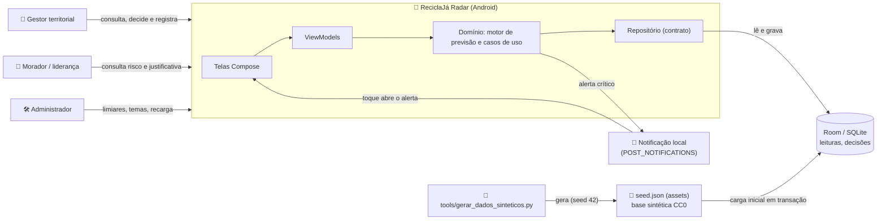

**Camadas e módulos do app** (as setas indicam dependência; quem está em cima depende do contrato de baixo)

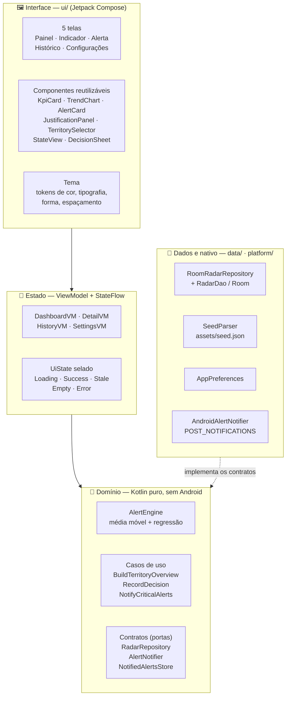

### 3.4 Perguntas norteadoras

- **Responsabilidade:** a tela só desenha e repassa eventos. O ViewModel transforma o fluxo em `UiState`. O domínio decide nível, confiança e validação. O repositório só lê e grava.
- **Dependência:** o domínio **não importa** nada de `android.*`, Room ou Compose. Os testes JVM provam isso, porque compilam e rodam sem o SDK Android.
- **Substituição:** trocar o seed sintético por uma API pública significa uma nova implementação de `RadarRepository`. `AlertEngine`, casos de uso e telas não mudam.
- **Risco:** a primeira fronteira a falhar é a **permissão** (negada é o caso comum no Android 13+). Por isso o plano B é o próprio painel. A segunda é **dados velhos** (sensor parado), tratada no domínio.
- **Complexidade:** a injeção é manual, sem Hilt, e o projeto tem módulo único. Isso foi escolhido para caber no prazo do trio; o custo está registrado no ADR.

## 4. Etapa 3 — Estado, APIs e persistência de dados

### 4.1 Gerenciamento de estado

| Item | Preenchimento da equipe |
|---|---|
| **Solução adotada** | `ViewModel` + `StateFlow` (via `stateIn(WhileSubscribed(5s))`) por tela. A tela coleta com `collectAsStateWithLifecycle()`. Estado de formulário efêmero usa `rememberSaveable` (`DecisionSheet`, editores de limiar). Sem Hilt: fábrica única `viewModelFactory` e `AppContainer`. |
| **Tipos de estado** | **Local:** folha de decisão aberta, campos digitados, diálogo de confirmação (`rememberSaveable`). **Compartilhado:** território selecionado e tema clima, com dono único em `AppPreferences` (expostos como `StateFlow` e persistidos). **De dados:** leituras, indicadores e decisões vindos do Room como `Flow`. |
| **Estados de tela** | `sealed interface UiState { Loading; Success(data); Stale(data, lastUpdate); Empty(message); Error(message) }`, renderizados de forma uniforme por `StateView` (carregando, sem dados, erro com "Tentar novamente", dados desatualizados). |
| **Fluxo de dados** | Toque no chip do território → `vm.select(id)` → `AppPreferences.selectTerritory` (StateFlow) → `combine(territories, indicators, showClimate, selected, retry)` → `flatMapLatest { repository.readings(id) }` → `BuildTerritoryOverviewUseCase` → `UiState` → recomposição. O evento sobe e o estado desce. |
| **Ciclo de vida** | ViewModels sobrevivem à rotação. Rotas recebem só IDs, lidos de `SavedStateHandle` (sobrevivem à morte do processo). `stateIn(WhileSubscribed(5000))` evita recarregar na rotação. O seed usa `Mutex` e é idempotente (`ensureSeeded`), então não há carga duplicada. Botão Voltar: pilha do Navigation, abas com `saveState/restoreState`. |
| **Estado derivado** | Indicadores, variação semanal, previsão e alertas **não são persistidos**: são calculados a partir das leituras (`TerritoryOverview.alerts` é derivado de `items`). Com isso não existe alerta "fantasma" divergente dos dados. |

### 4.2 Fontes de dados

| Item | Preenchimento da equipe |
|---|---|
| **Origem e licença** | **Base sintética ReciclaJá v2026.11.1**, JSON (`app/src/main/assets/seed.json`), licença **CC0 1.0** (dados fictícios). O formato foi inspirado em dados abertos de coleta seletiva e de precipitação (INMET); nenhum valor real foi copiado. Metadados exibidos em Configurações → Fonte dos dados. |
| **Carga dos dados** | Na primeira abertura, `RoomRadarRepository.ensureSeeded()` lê o JSON de `assets` (em `Dispatchers.IO`) e grava territórios, indicadores e leituras em **uma transação** (`RadarDao.replaceSeed`). O domínio recebe os dados pelo contrato `RadarRepository` como `Flow`. |
| **Dados sintéticos** | Gerados por `tools/gerar_dados_sinteticos.py` (determinístico, `random.seed(42)`): 6 territórios, 4 indicadores, 30 dias e 453 leituras, com perfis de alta, estável, desatualizado (sensor parado há 5 dias), insuficiente (5 dias de histórico) e sem dados. Na tela: selo "Dados sintéticos (fictícios)" no painel, no alerta e em cada leitura. |
| **Atualização e validade** | Leituras usam `dayOffset` e são reancoradas na data da carga, o que mantém a demonstração coerente. Nova carga acontece a cada versão ou pelo botão "Recarregar base sintética". Validade: leitura com **mais de 2 dias** deixa o indicador "Desatualizado" e o alerta não é emitido. O painel mostra "Base carregada há X" e a data da última leitura. |
| **Privacidade** | Somente dados agregados por bairro e fictícios. Nenhum CPF, endereço ou telefone. Nenhum dado pessoal no repositório. |

### 4.3 Persistência de dados

| Item | Preenchimento da equipe |
|---|---|
| **Tecnologia escolhida** | **Room 2.7 sobre SQLite** para séries temporais e decisões (consultas por território e indicador com índice, Flow reativo e transação). **SharedPreferences** para preferências simples (território, tema, flags de permissão, chaves de alerta já notificado). DataStore seria uma dependência a mais para 5 chaves. |
| **O que é persistido** | Leituras (série temporal), territórios, indicadores com limiares editáveis, histórico de decisões, território favorito, tema clima, data da última carga, alertas já notificados e "permissão já solicitada". |
| **Offline é regime normal** | O app **não tem permissão de INTERNET**. Toda leitura vem do banco local. A política de atualização é recarga por versão ou manual, e o usuário vê a data da carga e da última leitura. |
| **Repositório** | `RadarRepository` (interface no domínio) isola Room e assets. Trocar SQLite por outra base ou o seed por uma API REST é escrever outra implementação, sem mudar o domínio. |
| **Privacidade** | Armazenado: nome do responsável e observação das decisões, só no aparelho, até o usuário apagar (Configurações → "Apagar histórico de decisões"). `allowBackup=false` impede que o histórico vá para backup em nuvem. Coleta: o próprio gestor digita. Guarda: o app, localmente. |

### 4.4 Modelo de dados

| Entidade | Atributos (como implementados) |
|---|---|
| **Território** | `id`, `name`, `type` (CIDADE, BAIRRO, AREA_RURAL), `lat`, `lon` |
| **Indicador** | `id`, `theme` (RESIDUOS, CLIMA), `name`, `unit`, `attention`, `critical` (limiares), `description` |
| **Leitura** | `id`, `territoryId`, `indicatorId`, `timestamp`, `value`, `origin` (PUBLICA, SINTETICA, AUTORIZADA). Índice em (territoryId, indicatorId, timestamp) |
| **Alerta** (derivado, não persistido) | `level` (INFORMATIVO, ATENCAO, CRITICO), `confidence`, `forecastValue`, `forecastHorizonDays`, `justification` (variáveis, regra, período, fonte, atualizadoEm), `key` estável |
| **Decisão** | `id`, `alertKey`, `territoryId`, `indicatorId`, `alertLevel`, `alertTitle`, `action` (ACATAR, ADIAR, DESCARTAR), `responsible`, `note`, `createdAt` |

### 4.5 Recursos nativos e permissões

O recurso nativo escolhido é a **notificação local de alerta crítico**, sempre atrás do adaptador `AlertNotifier`. A tela nunca chama a API do Android diretamente.

| Recurso | Risco | Plano B implementado |
|---|---|---|
| Notificação local de alerta crítico | Permissão negada (Android 13+ exige `POST_NOTIFICATIONS`) ou notificações desligadas nas configurações | Banner vermelho no painel: "Notificações desativadas, você só será avisado aqui". Com **negada permanentemente**, o mesmo botão vira "Abrir configurações do sistema" (atalho `ACTION_APP_NOTIFICATION_SETTINGS`). O alerta continua visível no painel. |
| Armazenamento local | Gravação parcial ou espaço insuficiente | Carga do seed em **transação única** no Room: entra tudo ou nada. Erro de leitura vira `UiState.Error` com "Tentar novamente". |
| Localização para sugerir território | (Não usada nesta versão) | Seleção manual do território com favorito persistido. Localização entra no roadmap. |

Os três caminhos da permissão (**concedida, negada e negada para sempre**) foram testados no emulador e aparecem no vídeo e nas capturas `12a`, `12`, `12b`, `12c` e `13`. A permissão só é pedida no toque em "Ativar notificações", com o motivo escrito na tela. Ao voltar das configurações, o status é recalculado (`ON_RESUME`) e o alerta pendente é notificado.

## 5. Etapa 4 — Identidade visual e componentes reutilizáveis

### 5.1 Identidade visual (design tokens)

| Elemento | Preenchimento da equipe |
|---|---|
| **Conceito e marca** | **ReciclaJá Radar**: um radar (arcos concêntricos) sobre um contêiner de coleta, com um ponto âmbar de alerta. A ideia é "ver o problema antes de ele transbordar". O verde-floresta remete a limpeza urbana e sustentabilidade, sem o verde-limão genérico. Ícone adaptativo vetorial próprio. |
| **Tema único** | `RadarTheme` em `ui/theme/Theme.kt`: `Palette` (tokens), `ColorScheme` claro e escuro, `Typography` (6 níveis), `Shapes` (8, 12 e 20 dp), `Spacing` (4, 8, 16 e 24 dp) e `StatusColors` (CompositionLocal) para as cores semânticas. Nenhuma cor solta nas telas. |
| **Paleta de cores** | Primária `#1B6B3A` (verde-floresta), secundária `#00695C`. Semânticas no claro: Normal `#2E7D32`, Informativo `#1565C0`, Atenção `#8A5300`, Crítico `#B3261E`. No escuro: `#81C784`, `#90CAF9`, `#FFCA28`, `#EF9A9A`. **Todos os 11 pares ≥ 4,5:1** (mínimo 5,13:1), verificados por script no CI. |
| **Tipografia e espaçamento** | 6 níveis: headlineSmall 24, titleMedium 18, titleSmall 15, bodyLarge 16, bodyMedium 14, labelMedium 12 sp. Grade de 4 dp. Raios de 8, 12 e 20 dp. |
| **Iconografia e gráficos** | Material Icons (Warning, Info, CheckCircle, Notifications, Home, List, Settings). O gráfico é Canvas próprio: histórico em linha sólida verde, previsão tracejada cinza, limiar de atenção tracejado âmbar, crítico tracejado vermelho, legenda textual e eixos com valores e datas. |
| **Acessibilidade** | Alvos ≥ 48 dp (`heightIn(min = 48.dp)` em cards, chips e botões). `contentDescription` e `semantics(mergeDescendants)` em KpiCard, AlertCard e no gráfico (resumo falado para o TalkBack). `heading()` nos títulos de seção. **A cor nunca comunica sozinha**: nível sempre com ícone e rótulo (`LevelBadge`). Layout testado com fonte a 200% (FlowRow quebra linha, rótulos de aba curtos). |
| **Layout adaptativo** | Painel em `LazyVerticalGrid(GridCells.Adaptive(168.dp))`: 2 colunas no compacto, 3 a 4 no médio e expandido, definidas pelo conteúdo e não pelo modelo do aparelho. Sem medidas fixas em pixels: tudo em dp e sp, larguras com `fillMaxWidth` e `weight`. |

### 5.2 Componentes reutilizáveis

Todos recebem dados por parâmetro e devolvem eventos por callback. **Nenhuma regra de negócio dentro** (a validação da decisão, por exemplo, está no `RecordDecisionUseCase`).

| Composable | Responsabilidade | Parâmetros e callbacks | Usado em |
|---|---|---|---|
| **KpiCard** | Indicador com valor, unidade, variação de 7 dias e nível | `title, value, unit, variationPct, level, unavailable, onClick` | Painel, Detalhe do indicador |
| **TrendChart** | Série temporal com previsão tracejada e limiares | `title, history, forecast, attention, critical, unit` | Painel, Detalhe do indicador, Detalhe do alerta |
| **AlertCard** | Alerta com nível (ícone e rótulo), título, confiança e acesso à justificativa | `alert, subtitle, onClick` | Painel, Detalhe do indicador |
| **JustificationPanel** | Variáveis, regra, período, fonte e confiança | `justification, confidenceLabel, confidencePct` | Detalhe do indicador, Detalhe do alerta |
| **TerritorySelector** | Seleção de bairro ou área rural (rolagem horizontal) | `territories, selectedId, onSelect` | Painel, Configurações |
| **StateView** | Carregando, vazio, erro (com "Tentar novamente") e desatualizado | `kind, message, title, onRetry` | Todas as 5 telas |
| **LevelBadge / OriginTag** | Nível com ícone e rótulo / selo de origem do dado | `level, unavailable` / `text` | Todas as telas de dados |
| **DecisionSheet** | Registro da decisão humana | `alert, error, onDismiss, onEdited, onConfirm` | Detalhe do alerta |
| **DecisionRow** | Uma decisão registrada | `decision, context` | Detalhe do alerta, Histórico |

### 5.3 Telas mínimas e navegação

| Tela | Conteúdo implementado |
|---|---|
| **Painel** | Seletor de território, selo de dados sintéticos e data da carga, banner de plano B da notificação, alertas ativos ordenados por gravidade, grade de KPIs e gráfico de tendência da ocupação. |
| **Detalhe do indicador** | KPI, descrição, gráfico de 30 dias com previsão de 3 dias, situação da previsão (alerta e justificativa, ou motivo de não haver alerta) e últimas leituras com origem. |
| **Detalhe do alerta** | Nível, título, resumo, confiança, sugestão ("o app recomenda"), justificativa completa, gráfico dos dados que originaram o alerta, botão "Registrar decisão" e decisões anteriores. |
| **Histórico de decisões** | Lista das decisões com ação, nível, território, indicador, data/hora, responsável e observação. |
| **Configurações** (aba "Ajustes") | Território favorito, temas (clima liga/desliga), permissão de notificação com status e ação, limiares por indicador, fonte, licença e versão dos dados, recarga da base e exclusão do histórico (LGPD). |

| Rota (Navigation Compose) | Argumentos | Estado que cria, lê e descarta |
|---|---|---|
| `painel` (início) | — | `DashboardViewModel` (escopo da Activity): lê o território do `AppPreferences` e observa o Room. |
| `indicador/{territoryId}/{indicatorId}` | **Só IDs** | `DetailViewModel` lê os IDs do `SavedStateHandle` e é descartado ao voltar. |
| `alerta/{territoryId}/{indicatorId}` | **Só IDs** | `DetailViewModel` + estado local da folha (`rememberSaveable`). A decisão salva vai para o Room e sobrevive ao Voltar. O toque na notificação abre esta rota. |
| `historico`, `configuracoes` | — | Abas com `saveState/restoreState`: Voltar retorna ao Painel e preserva a rolagem. |

### 5.4 Telas do app (capturas reais do emulador)

<figure>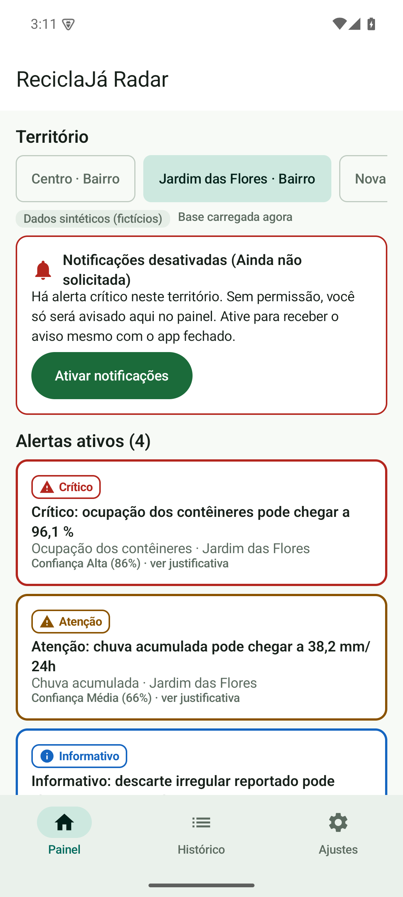<figcaption>Painel (Jardim das Flores) com plano B de notificação</figcaption></figure>
<figure>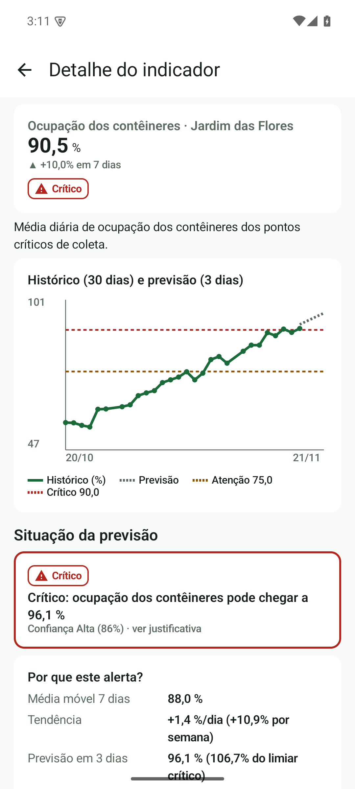<figcaption>Detalhe do indicador: 30 dias + previsão</figcaption></figure>
<figure>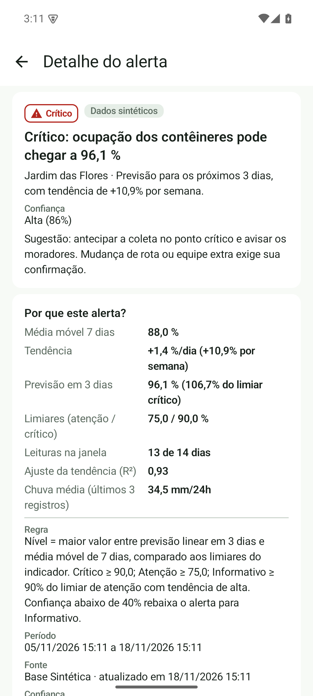<figcaption>Detalhe do alerta: nível, confiança, sugestão</figcaption></figure>
<figure>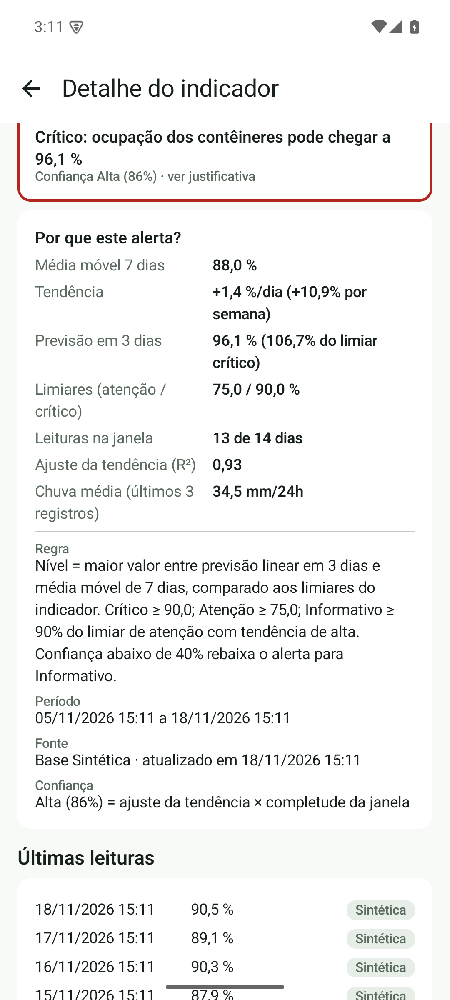<figcaption>Justificativa: variáveis, regra, período, fonte</figcaption></figure>
<figure>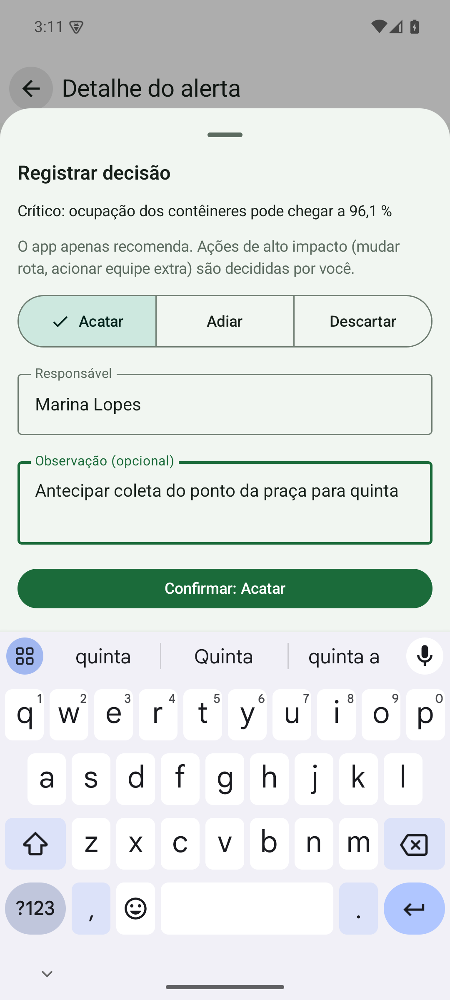<figcaption>Registro da decisão humana</figcaption></figure>
<figure>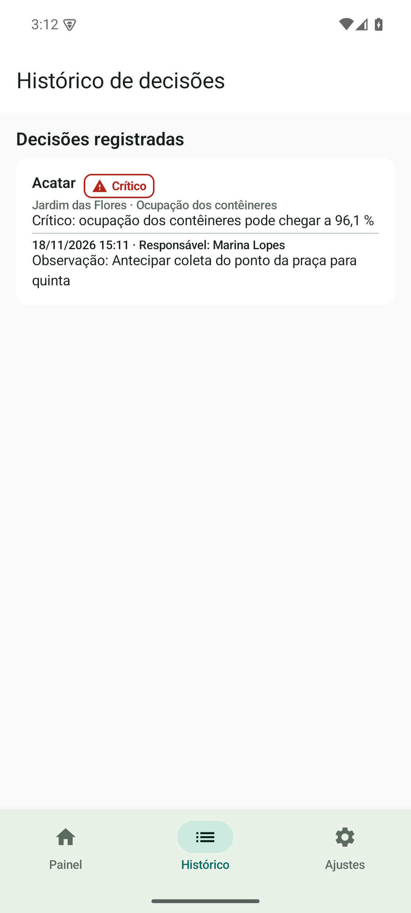<figcaption>Histórico de decisões</figcaption></figure>
<figure>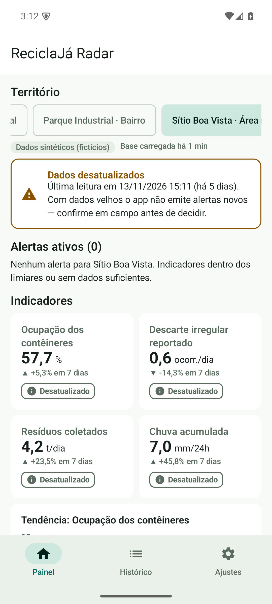<figcaption>Dados desatualizados: sem alerta novo</figcaption></figure>
<figure>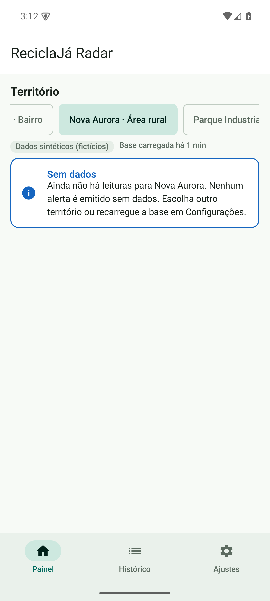<figcaption>Território sem dados</figcaption></figure>
<figure>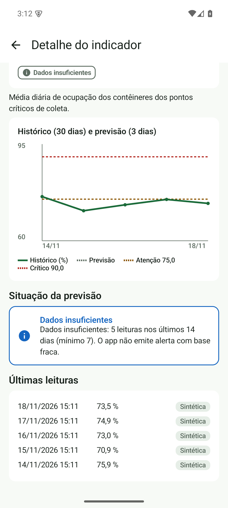<figcaption>Dados insuficientes</figcaption></figure>
<figure>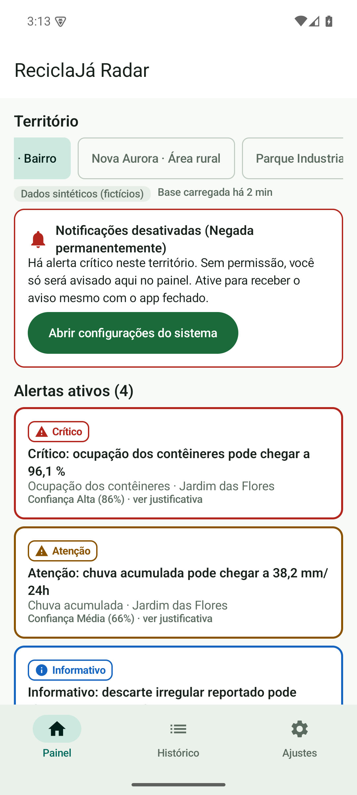<figcaption>Permissão negada para sempre → atalho</figcaption></figure>
<figure>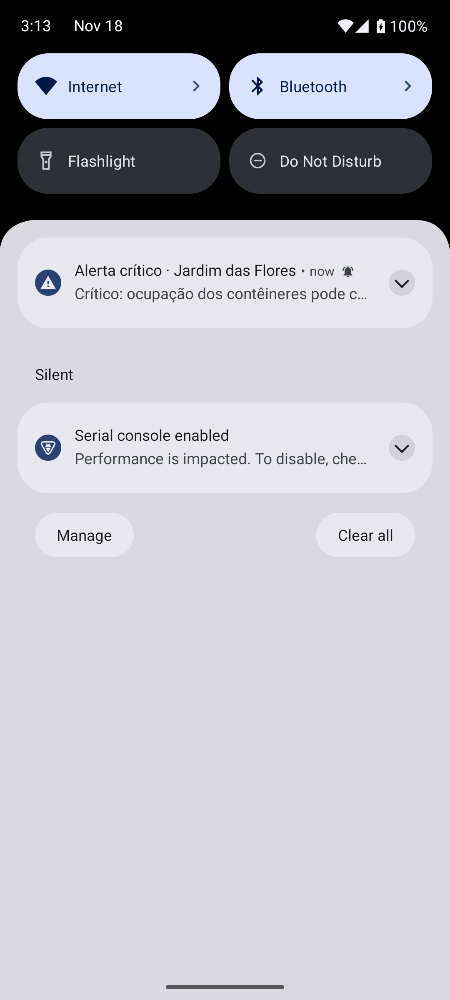<figcaption>Notificação local do alerta crítico</figcaption></figure>
<figure>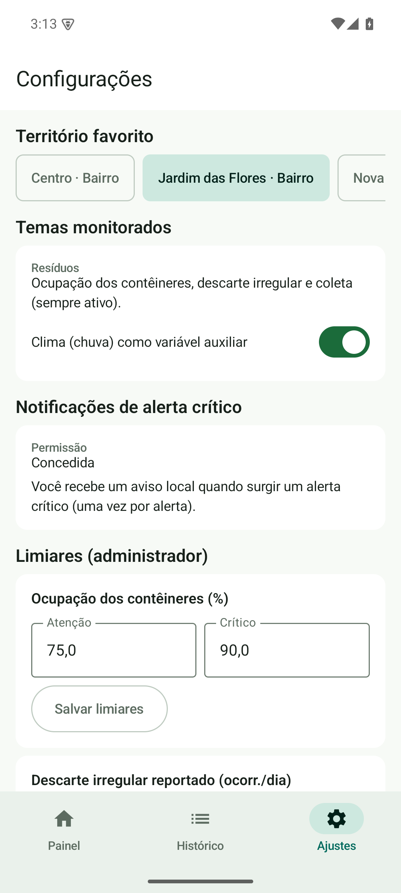<figcaption>Configurações (Ajustes)</figcaption></figure>
<figure>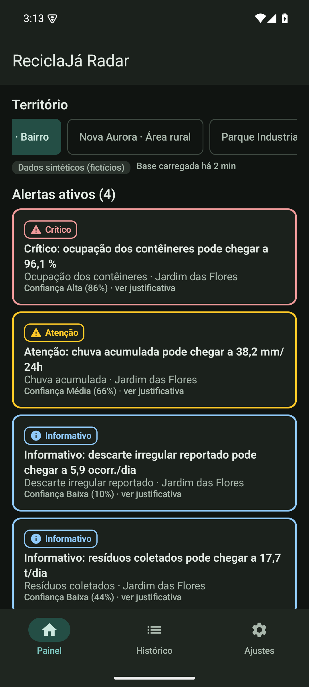<figcaption>Modo escuro</figcaption></figure>
<figure>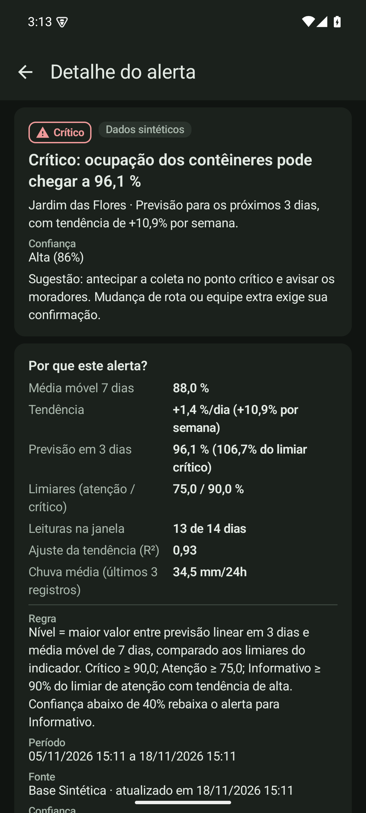<figcaption>Alerta no modo escuro</figcaption></figure>

## 6. Etapa 5 — Alertas preditivos e decisão humana

| Item | Preenchimento da equipe |
|---|---|
| 🔮 **Método de previsão** | **Média móvel de 7 dias** (nível atual) + **regressão linear** sobre a janela de 14 dias (tendência), projetada **3 dias** à frente. O nível usa o **maior** entre previsão e média móvel versus os limiares. A escolha se justifica assim: é explicável em uma frase, roda offline em microssegundos e é testável com séries conhecidas (o teste prova previsão exata de 94,0 numa série linear). Modelos de ML ficaram fora: não temos histórico real para treinar, e um modelo opaco quebraria a justificativa obrigatória. |
| 🚦 **Níveis de alerta** | **Crítico:** referência ≥ limiar crítico (ocupação ≥ 90%). **Atenção:** ≥ limiar de atenção (≥ 75%). **Informativo:** ≥ 90% do limiar de atenção **e** tendência de alta. Abaixo disso não há alerta (Normal). **Rebaixamento:** confiança < 40% transforma Atenção ou Crítico em Informativo, com o motivo exibido. |
| 🔍 **Justificativa** | Painel "Por que este alerta?": média móvel de 7 dias, tendência (%/dia e % por semana), previsão em 3 dias (e % do limiar crítico), limiares, leituras na janela (ex.: 13 de 14 dias), R² da tendência, chuva média recente (variável auxiliar), regra textual completa, período (data inicial a final), fonte e data de atualização. |
| 📉 **Confiança e limites** | Confiança = R² da regressão × completude da janela (leituras/14), exibida em % e como Alta (≥ 75%), Média (≥ 50%) ou Baixa. **O app não emite alerta** quando: não há leituras; a última leitura tem mais de 2 dias (desatualizado); há menos de 7 leituras na janela (insuficiente). Nesses casos o KPI mostra o selo correspondente e **nunca** "Normal". |
| 🧑‍⚖️ **Decisão humana** | O app só **recomenda** (Crítico: "antecipar a coleta e avisar moradores"; Atenção: "reforçar o monitoramento"; Informativo: "acompanhar"). Mudança de rota ou equipe extra **não é automatizada**. O gestor registra **Acatar, Adiar ou Descartar** com responsável (obrigatório) e observação (obrigatória para Adiar e Descartar). O registro tem data e hora e vai para o histórico. |
| ⚖️ **Riscos e ética** | **Falso positivo:** ruído pode cruzar o limiar; mitigado pela confiança e pelo rebaixamento. **Falso negativo:** evento súbito (feriado, chuva extrema) que a reta não capta; mitigado mostrando a chuva na justificativa, e a sazonalidade fica no roadmap. **Viés:** bairros com menos sensores têm menos leituras e, portanto, menor confiança; o app torna isso visível em vez de esconder. **LGPD:** só dados agregados e sintéticos, nenhum dado de morador. **Dados sintéticos** identificados em todas as telas. |

### 6.1 Alerta real gerado pelo app (base sintética)

| Elemento | Conteúdo exibido no app (captura `04_alerta.png`) |
|---|---|
| **Alerta** | 🔴 **Crítico: ocupação dos contêineres pode chegar a 96,1% — Jardim das Flores**, previsão para os próximos 3 dias. |
| **Justificativa** | Média móvel de 7 dias em 88,0%. Tendência de +1,4%/dia (+10,9% por semana). Previsão em 3 dias de 96,1% (106,7% do limiar crítico de 90%). 13 leituras em 14 dias. R² = 0,93. Chuva média recente de 34,5 mm/24h. |
| **Confiança e fonte** | Alta (86%). Base sintética, atualizada na data da carga. |
| **Ação humana** | O app sugere antecipar a coleta no ponto crítico. A gestora registrou **Acatar**, responsável "Marina Lopes" (fictícia), observação "Antecipar coleta do ponto da praça para quinta". |

## 7. Cenário crítico e diagrama de sequência

**Cenário:** a ocupação do Jardim das Flores tende a passar de 90% em 3 dias, e o gestor **negou a permissão de notificação**. O app não pode "falhar em silêncio".

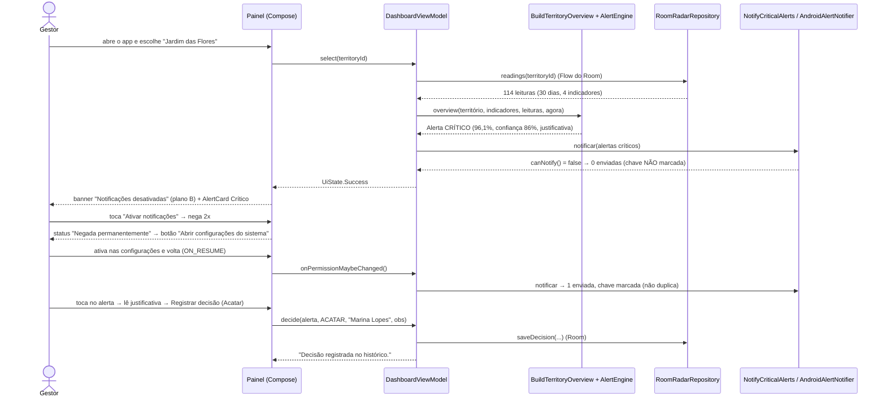

## 8. Etapa 6 — Decisões arquiteturais (ADR)

### ADR-001 — Motor de previsão explicável em Kotlin puro (média móvel + regressão linear), em vez de modelo de ML

| Campo | Conteúdo |
|---|---|
| **Status / Data** | ☐ Proposta ☑ **Aceita** ☐ Substituída — 18/11/2026 |
| **Contexto** | Todo alerta precisa de justificativa (variáveis, regra, período e fonte) e de confiança, e precisa rodar offline em celular intermediário. Não existe histórico real rotulado para treinar modelo. O critério de avaliação pede "regras explicáveis e modelos simples". O motor precisa ser testável sem emulador. |
| **Decisão** | Decidimos adotar um **motor determinístico em Kotlin puro** (`AlertEngine`): média móvel de 7 dias, regressão linear de 14 dias projetada em 3 dias, limiares por indicador editáveis pelo administrador, confiança = R² × completude, rebaixamento abaixo de 40% e bloqueio com dados velhos ou insuficientes. |
| **Alternativas consideradas** | (1) **TensorFlow Lite com modelo treinado:** descartado por não haver dados para treinar, por ser opaco (quebra a justificativa) e por somar cerca de 2 MB ao APK. (2) **Só limiar sobre o valor atual:** descartado porque é reativo; avisa quando já transbordou, o oposto de antecipar. (3) **Previsão calculada num servidor:** descartado porque o app precisa funcionar offline e o escopo da disciplina é local. |
| ➕ **Consequências positivas** | Justificativa gerada pela mesma conta que gera o alerta (sem divergência). 9 testes JVM cobrem crítico, atenção, normal, sem dados, desatualizado, insuficiente, lacunas, rebaixamento e regressão exata. Roda em microssegundos e o APK fica em 1,56 MB. O domínio pode migrar para KMP. |
| ➖ **Consequências negativas** | Não capta sazonalidade (feriado, fim de semana) nem eventos súbitos, o que gera **falso negativo** possível. A reta extrapola indefinidamente; limitamos a 3 dias. Os limiares dependem do administrador. Custo assumido: revisar o método se o falso positivo ou negativo medido em piloto passar de 20%. |

### ADR-002 — Injeção de dependências manual (AppContainer) em vez de Hilt

| Campo | Conteúdo |
|---|---|
| **Status / Data** | ☑ **Aceita** — 18/11/2026 |
| **Contexto** | Grafo pequeno: um repositório, um motor, três casos de uso, um notifier e quatro ViewModels. Build precisa ser rápido no CI. A equipe tem pouca experiência com Hilt e kapt/KSP extra. |
| **Decisão** | Um `AppContainer` criado no `Application` monta o grafo. Os ViewModels vêm de um `viewModelFactory` único. |
| **Alternativas** | **Hilt:** descartado por exigir mais plugin, anotações e tempo de build para pouco ganho em 5 telas. **Koin:** descartado porque a resolução em tempo de execução esconde erro de grafo até rodar. |
| ➕ / ➖ | ➕ Zero dependência extra e grafo legível num arquivo de 30 linhas. ➖ Não escala para dezenas de telas e não tem escopos automáticos. Migrar para Hilt se o app passar de cerca de 10 telas. |

### Da decisão à justificativa

| Decisão | Alternativa descartada | Critério | Preenchimento da equipe |
|---|---|---|---|
| **Plataforma do app** | Flutter, React Native ou nativo separado | Prazo, equipe e experiência no Android | Android nativo (Kotlin + Compose): é o que o trio domina, sem ponte JS e sem plugins de terceiros para Room e notificação, com APK de 1,56 MB. **Custo:** iOS exigiria nova UI. O domínio em Kotlin puro reduz esse custo (KMP). |
| **Gestão de estado** | Estado local nas telas | Complexidade real do fluxo | ViewModel + StateFlow + `UiState` selado: o mesmo fluxo (território → leituras → overview) alimenta 3 telas e sobrevive à rotação. **Custo:** mais uma camada; o estado efêmero de formulário ficou com `rememberSaveable`. |
| **Origem dos dados** | Consumo de API remota | Escopo da disciplina e uso offline | Seed JSON em assets → Room, sem permissão INTERNET. **Custo:** dados sintéticos (rotulados na tela); trocar por API real é uma nova implementação de `RadarRepository`. |
| **Acesso a recursos nativos** | Chamar a API do Android direto na tela | Testabilidade e risco de manutenção | `AlertNotifier` (porta no domínio) + `AndroidAlertNotifier` (adaptador). A regra "só crítico, uma vez, só com permissão" é testada com fake. **Custo:** uma interface a mais. |
| **Entrega do build** | Build manual no Android Studio | Repetibilidade | GitHub Actions a cada push: contraste, testes e `assembleDebug` + `assembleRelease` (R8), com APKs como artefato. **Custo:** APK de avaliação assinado com a chave debug (a keystore privada não vai para o repositório). |

## 9. Etapa 7 — Qualidade, testes e entrega do app

### 9.1 Definition of Done

| Critério mínimo | Cumprido | Evidência / observações |
|---|---|---|
| Requisito implementado e critérios de aceite validados | ☑ | RF01–RF08 demonstrados no vídeo e nas capturas `docs/screenshots/01`–`15`. |
| Fluxo principal validado de ponta a ponta no emulador | ☑ | Pixel 6, API 35 (AVD `radar_api35`): painel → alerta → decisão → histórico, gravado com `adb screenrecord`. |
| Todo alerta exibido com justificativa, confiança e fonte | ☑ | `JustificationPanel` em todo alerta. O teste `tendencia de alta...` verifica variáveis, regra e fonte. |
| App degrada com clareza com dados ausentes e permissão negada | ☑ | Nova Aurora (sem dados), Sítio Boa Vista (desatualizado), Parque Industrial (insuficiente), banner de plano B e status "Negada permanentemente". |
| Build instalável (APK) com minSdk e targetSdk declarados | ☑ | `entregas/ReciclaJaRadar-1.0.0-release.apk`: minSdk 26, targetSdk 36, versionName 1.0.0. |
| Código revisado por outro integrante | ☑ | Domínio (Gustavo Maia) revisado por Gustavo Rossi. UI (Gustavo Rossi) revisada por Gabriel Fidalgo. Dados e nativo (Gabriel Fidalgo) revisados por Gustavo Maia. |
| Decisão arquitetural registrada em ADR | ☑ | ADR-001 e ADR-002 (seção 8). |
| Uso de IA registrado (prompt, alternativas, validação, autor) | ☑ | Seção 10.1. |
| Sem dados pessoais, chaves ou credenciais no repositório | ☑ | Seed CC0 fictício, sem keystore, sem `.env`, sem chave de API (o app não usa rede). |
| Sem defeitos críticos ou bloqueantes em aberto | ☑ | Fluxo completo no release R8 sem crash (`adb logcat -b crash` vazio). |
| Documentação da funcionalidade atualizada | ☑ | Este documento + `README.md` + roteiro de defesa. |

### 9.2 Plano de evidências de qualidade (meta definida antes, medida antes e depois)

Ambiente de medição: emulador Pixel 6, Android 15 (API 35, arm64, GPU swiftshader), build **release**. Os scripts estão no repositório (`tools/`) e qualquer pessoa pode reproduzir.

| Atributo | Meta | Como medir | Antes | Depois | Prova |
|---|---|---|---|---|---|
| **Acessibilidade (contraste)** | 100% dos pares ≥ 4,5:1 | `python3 tools/contraste.py` (WCAG 2.1; roda no CI) | **6/11** pares (pior: Atenção `#F2A900` em branco = **2,01:1**) | **11/11** (mínimo **5,13:1**) | `contraste_antes.txt` / `contraste_depois.txt`, capturas `contraste_antes_painel.png` e `contraste_depois_painel.png`, commit `fix(a11y): paleta...` |
| **Consumo de recursos (tamanho)** | APK ≤ 5 MB | tamanho do `app-release.apk` | **8.433.806 B** (8,43 MB, sem R8) | **1.563.095 B** (1,56 MB, R8 + shrinkResources): **−81%** | `docs/evidencias/medicoes_r8.txt` |
| **Consumo de recursos (memória)** | PSS ≤ 40 MB com o painel aberto | `tools/medir_memoria.sh` (`dumpsys meminfo`, mediana de 5) | **47.811 KB** | **32.788 KB**: **−31%** | `medicoes_r8.txt` |
| **Acessibilidade (fonte 200%)** | Nenhum texto espremido ou palavra quebrada no painel | Configurações do sistema → fonte 2,0; captura do painel | "Base carregada há 2 min" quebrado letra a letra; aba "Configuraç-ões" partida | Texto quebra para a linha de baixo (FlowRow); aba "Ajustes" em 1 linha | `fonte200_antes.png` / `fonte200_depois.png` |
| **Desempenho de tela (abertura a frio)** | ≤ 1.000 ms | `tools/medir_cold_start.sh` (`am start -W`, mediana de 15, após `compile speed-profile`) | **279 ms** (sem R8; faixa de 239 a 366) | **334 ms** (com R8; faixa de 231 a 713) | `medicoes_r8.txt`. **Leitura honesta:** o R8 **não** melhorou a abertura no emulador; a diferença está dentro da variação do swiftshader. As duas versões cumprem a meta com folga. |
| **Estabilidade** | Nenhuma falha no fluxo principal | Logcat (`-b crash`) após o fluxo completo gravado | — | 0 crashes | Vídeo + logcat |

### 9.3 Testes automatizados

`./gradlew testDebugUnitTest`: **15 testes, 0 falhas**, rodando no CI a cada push.

| Classe | Testes |
|---|---|
| `AlertEngineTest` (9) | crítico com justificativa completa e previsão exata (94,0); atenção estável; normal; sem leituras; desatualizado > 2 dias mesmo com valor crítico; insuficiente (5 de 7); lacunas reduzem a confiança; regressão recupera a inclinação; baixa confiança rebaixa para Informativo |
| `UseCasesTest` (6) | decisão válida persistida com responsável e data; sem responsável é rejeitada e nada é salvo; descartar exige motivo; notifica só crítico e uma vez; sem permissão não notifica e não marca; overview ordena por gravidade e anexa a chuva |

### 9.4 Entregáveis

| Entregável | Descrição | Entregue |
|---|---|---|
| 📄 Documento PDF | Este documento, com diagramas e referências | ☑ |
| 💻 Repositório de código | <https://github.com/gustavopmaia/gs2026-2-reciclaja-radar>, com README de instalação, execução, arquitetura e decisões | ☑ |
| 📲 Build instalável | `entregas/ReciclaJaRadar-1.0.0-release.apk` (minSdk 26, targetSdk 36), testado no emulador Pixel 6 API 35. Também é gerado pelo CI como artefato | ☑ |
| 🗂️ Dados sintéticos documentados | `tools/gerar_dados_sinteticos.py` + `app/src/main/assets/seed.json` (origem, licença CC0 e finalidade no bloco `meta`) | ☑ |
| 📏 Evidências de qualidade | Seção 9.2 + `docs/evidencias/` | ☑ |
| 🤖 Registro de uso de IA | Seção 10.1 | ☑ |
| 🎬 Vídeo demonstrativo | Até 3 min: painel, gráficos, alerta com justificativa, decisão humana, dados ausentes e permissão negada (link no README) | ☑ |
| 📚 Referências | Seção 11 | ☑ |

## 10. Etapa 8 — Uso responsável de IA e roteiro de defesa

### 10.1 Registro de uso de IA

A IA foi usada como **apoio pontual**. Arquitetura, regras do motor, limiares, dados e decisões de escopo foram definidos pela equipe.

| Item | Preenchimento da equipe |
|---|---|
| **Onde a IA ajudou** | Ferramenta: assistente de IA generativa (Claude, Anthropic), via chat. (1) **Rascunho do `TrendChart`** em Canvas (desenho da linha, linhas tracejadas e `drawText`). (2) **Boilerplate do Room** (entidades, `@Dao` e `@Database`) a partir do nosso modelo de dados. (3) **Revisão de texto** de trechos deste documento (ortografia e clareza). |
| **Especificação e alternativas** | Exemplo de prompt (TrendChart): *"Composable Jetpack Compose que desenha uma série temporal com Canvas, sem biblioteca. Entrada: lista de (timestamp, valor), lista de pontos de previsão e dois limiares. Saída: linha sólida para o histórico, tracejada para a previsão, linhas tracejadas para os limiares, rótulos de min/max e datas nos eixos. Restrições: sem cor fixa (receber do tema), semantics com resumo para o TalkBack. Pronto quando: renderiza 30 pontos sem cortar rótulos em 360 dp."* Alternativas comparadas: **Vico** (biblioteca de gráficos Compose: rica, mas +~400 KB e API em mudança), **MPAndroidChart** (View, não Compose, exige `AndroidView`) e **Canvas próprio** (escolhido: zero dependência e controle da acessibilidade). |
| **Como foi validado** | Execução no emulador (capturas e vídeo), revisão linha a linha em par e ajustes manuais: o eixo Y começava em 0 e achatava a curva, e foi corrigido para 85% do mínimo; a legenda ganhou FlowRow para fonte a 200%. O boilerplate do Room foi validado pelo schema exportado (`app/schemas/.../1.json`) e pelo fluxo de carga e leitura. Só entrou o que sabemos explicar em voz alta. |
| **Responsável** | TrendChart: **Gustavo Rossi** (responsável pelo trecho), revisado por Gabriel Fidalgo. Room: **Gustavo Maia**, revisado por Gabriel Fidalgo. Revisão de texto: **Gabriel Fidalgo**, conferido pelos três. |
| **O que a IA não decide** | Regras e limiares de alerta, método de previsão (ADR-001), geração e interpretação dos dados, textos de recomendação ao gestor, qualquer decisão de alto impacto e qualquer dado pessoal. **Nunca** usamos IA para gerar dados de pessoas reais nem para fabricar resultados de medição: todos os números da seção 9.2 saíram dos scripts. |

### 10.2 Roteiro de defesa (10 minutos)

| Tempo | Bloco | O que apresentar | Quem |
|---|---|---|---|
| 2 min | Problema e valor | Transbordo de contêineres percebido tarde, com chuva agravando. Para quem: gestor territorial em campo, sem internet. Valor: antecipar em 3 dias, com justificativa, e registrar a decisão. | Gabriel Fidalgo |
| 3 min | Decisão de arquitetura | Blueprint em camadas + MVVM. ADR-001: motor explicável vs. ML. Alternativas descartadas (TFLite, limiar simples, servidor), critério (justificativa obrigatória, offline, testável) e custo (sem sazonalidade, possível falso negativo). Flutter e RN descartados por equipe e escopo; o domínio em Kotlin puro migra para KMP. | Gustavo Maia |
| 3 min | Demonstração real | Painel do Jardim das Flores, alerta crítico, justificativa e confiança, decisão "Acatar" com responsável, histórico. Depois a falha prevista: Sítio Boa Vista (desatualizado), Nova Aurora (sem dados), permissão negada duas vezes, banner de plano B, configurações e notificação. | Gustavo Rossi |
| 2 min | Riscos e próximos passos | Riscos: (1) falso negativo por sazonalidade; (2) dados sintéticos (validar com dados reais de cooperativa); (3) limiares mal calibrados. Fora do escopo: iOS, login, sincronização. Roadmap: sazonalidade semanal, localização para sugerir território, feedback do morador, KMP para iOS. | Os três |

## 11. Referências

- Android Developers. *Guide to app architecture* (camadas UI, domínio e dados). <https://developer.android.com/topic/architecture>
- Android Developers. *StateFlow and SharedFlow*; *ViewModel overview*; *Save UI states*. <https://developer.android.com/topic/libraries/architecture>
- Android Developers. *Save data in a local database using Room*. <https://developer.android.com/training/data-storage/room>
- Android Developers. *Notification runtime permission (POST_NOTIFICATIONS)*. <https://developer.android.com/develop/ui/views/notifications/notification-permission>
- Android Developers. *Navigation with Compose*. <https://developer.android.com/develop/ui/compose/navigation>
- Android Developers. *Accessibility in Compose*; *Shrink, obfuscate, and optimize your app (R8)*. <https://developer.android.com/develop/ui/compose/accessibility>
- W3C. *Web Content Accessibility Guidelines (WCAG) 2.1 — 1.4.3 Contrast (Minimum)*. <https://www.w3.org/TR/WCAG21/>
- Material Design 3. *Color system* e *Accessibility*. <https://m3.material.io>
- Nygard, M. *Documenting Architecture Decisions* (formato ADR), 2011.
- INMET — Instituto Nacional de Meteorologia. *Dados históricos* (referência de formato para precipitação). <https://portal.inmet.gov.br/dadoshistoricos>
- Brasil. *Lei nº 13.709/2018 — Lei Geral de Proteção de Dados Pessoais (LGPD)*.
- Bibliotecas: Jetpack Compose (BOM 2026.02.01), Material 3, Room 2.7.1, Navigation Compose 2.8.9, Lifecycle 2.8.7, Kotlin Coroutines 1.9.0, JUnit 4.13.2.

## 12. Checklist final

| | | |
|---|---|---|
| ☑ Capa | ☑ Integrantes | ☑ Documento de Visão |
| ☑ Arquitetura e Blueprint | ☑ Estado e Persistência | ☑ Identidade Visual e Componentes |
| ☑ Alertas e Decisão Humana | ☑ ADR | ☑ Definition of Done |
| ☑ Plano de Evidências (4 provas) | ☑ Uso Responsável de IA | ☑ Roteiro de defesa |
| ☑ Repositório e Build instalável (APK) | ☑ Vídeo demonstrativo | ☑ Referências |
